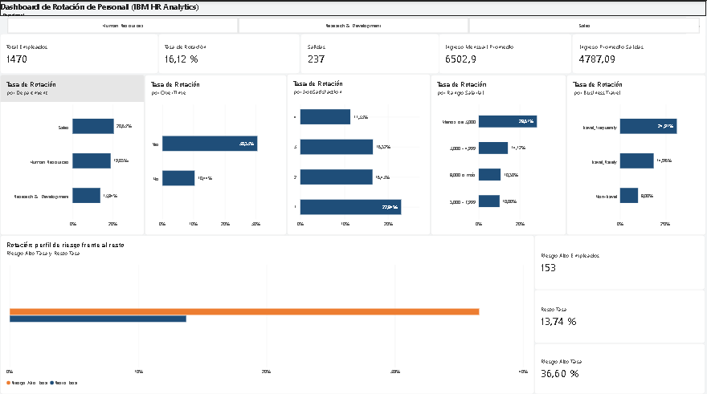

# HR Analytics — Rotación de personal (IBM)

Análisis de rotación de 1,470 empleados con limpieza en Python y dashboard interactivo en Power BI. La pregunta de negocio: ¿quién se va, por qué, y qué perfil de empleado conviene revisar primero?

## Dashboard

🔗 Dashboard publicado: [https://app.powerbi.com/links/nKtHqlCKXC?ctid=3374819b-3f7f-4153-ab6a-fd4afd7b386c&pbi_source=linkShare]

## Hallazgos principales

| Hallazgo | Cifra |
|---|---|
| Rotación general | 16.1% (237 de 1,470) |
| Departamento con más rotación | Sales (20.6%) |
| Rol con más rotación | Sales Representative (39.8%) |
| Horas extra | 30.5%, frente a 10.4% sin horas extra |
| Viajes frecuentes | 24.9%, frente a 8.0% sin viajes |
| Satisfacción baja (nivel 1) | 22.8%, frente a 11.3% en nivel 4 |
| Salario de quienes se van | 4,787 al mes, frente a 6,833 de quienes se quedan |

**Perfil de mayor riesgo:** 153 empleados que hacen horas extra y tienen satisfacción baja. Su rotación es de 36.6%, frente a 13.7% del resto, y concentran el 24% de las salidas.

**Variable no concluyente:** años desde la última promoción. La rotación no sigue una tendencia clara, y los grupos con más años tienen muy pocos empleados.

## Limitaciones

- El análisis muestra asociación, no causa. Los factores se traslapan entre sí.
- Es un dataset de IBM con datos ficticios: sirve para practicar el método, no para conclusiones sobre una empresa real.
- El umbral de salario de 5,000 es una referencia del análisis, no un punto de corte validado.
- No sabemos si la distancia hace que la gente se vaya o si quien se va ya había encontrado trabajo más lejos.

## Estructura del proyecto
hr-analytics/
├── data/
│ ├── raw/ # Dataset original (IBM HR)
│ └── processed/ # hr_attrition_clean.csv
├── notebooks/
│ └── 01_eda_hr.ipynb # Limpieza, análisis y conclusiones
├── dashboards/
│ └── hr_dashboard.pbix # Dashboard de Power BI
├── images/
│ └── dashboard_pagina1.png
└── README.md

## Cómo reproducirlo

1. Activa el entorno: `conda activate sales`
2. Ejecuta `notebooks/01_eda_hr.ipynb` de principio a fin.
3. Abre `dashboards/hr_dashboard.pbix` en Power BI Desktop.

---

**Autor:** Guillermo Adrianza · Ingeniero en Sistemas